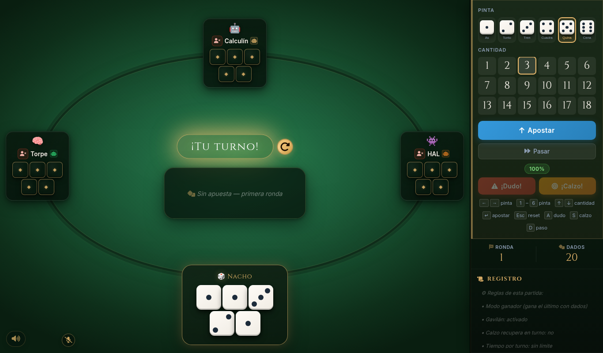
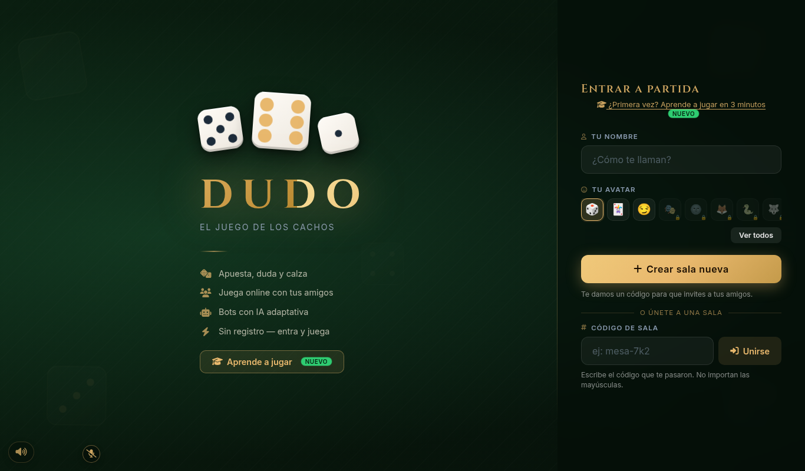
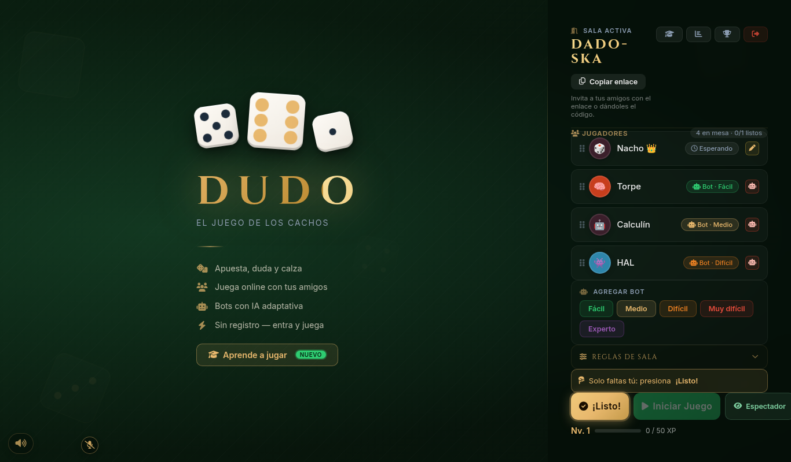
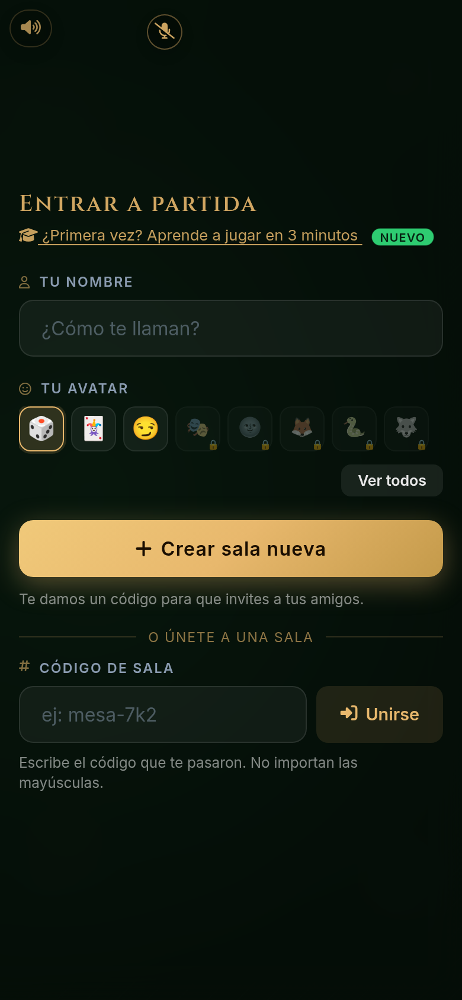
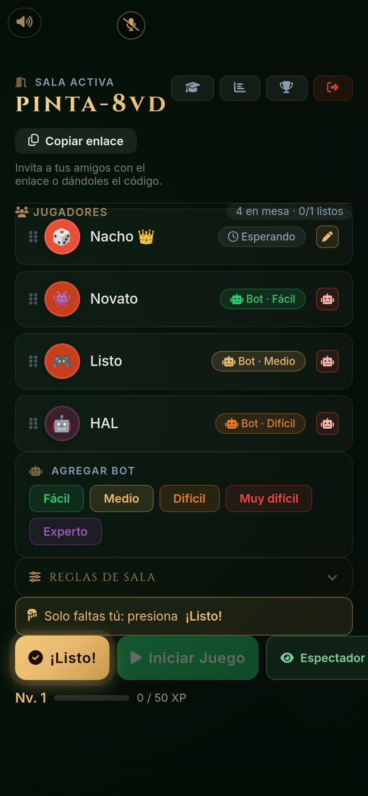
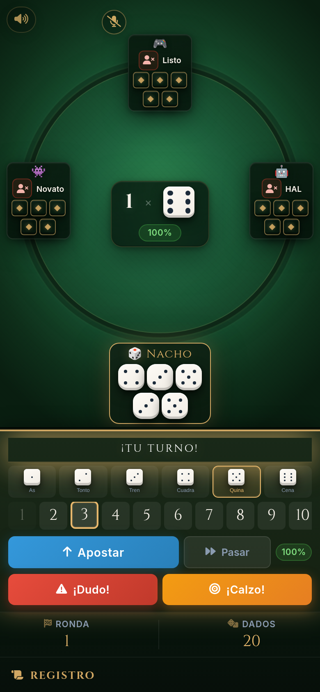

# 🎲 Dudo — El Juego de los Cachos (Cacho, Perudo, Liar's Dice)

[](https://github.com/ignaciovillela/dudo/actions/workflows/docker.yml) [](LICENSE)

## 👉 [Juega gratis ahora en dudo.igna.cl](https://dudo.igna.cl/)

Sin registro, desde el celular o el computador: crea una sala, comparte el enlace con tus amigos o juega contra bots. ¿Primera vez? Mira [cómo jugar y las reglas](https://dudo.igna.cl/como-jugar-dudo).

<p align="center">
  
</p>

**Dudo** —en Chile también "los cachos" o "cacho"— es un juego de dados multijugador en tiempo real. Es el mismo juego que en otros países se conoce como **Perudo**, **Cachito**, **Pico**, **Dadinho** o **Liar's Dice** (mundo anglosajón). Cada jugador oculta sus dados; por turnos se apuesta cuántos dados de una pinta hay en toda la mesa, y quien no cree la apuesta dice **¡Dudo!** o **¡Calzo!**. Gana el último con dados.

## Un juego, muchos nombres

Dudo (del español "yo dudo") se juega en toda Sudamérica con distintos nombres y pequeñas variaciones: **Dudo**, **Cacho** o **Cachos** (por el vaso de cuero o asta donde se agitan los dados), **Cachito**, **Perudo**, **Pico**, **Dadinho** y, en inglés, **Liar's Dice**. Esta versión sigue las reglas chilenas, con las pintas por sus nombres de siempre: *as*, *tonto*, *tren*, *cuadra*, *quina* y *cena*, y las jugadas **Dudo**, **Calzo** y **Gavilán**.

## Capturas

**Web**

| Inicio | Sala |
|:--:|:--:|
|  |  |

**Móvil**

| Inicio | Sala | Partida |
|:--:|:--:|:--:|
|  |  |  |

## Características

- **Tiempo real** con WebSockets: salas con código o enlace de invitación, hasta 6 jugadores y espectadores.
- **Bots de 5 niveles** (fácil, medio, difícil, muy difícil y experto): del azar puro a una IA con memoria de rondas, modelado de rivales y bluff.
- **Reglas configurables por sala**: modo ganador o perdedor, Gavilán (dudar o calzar fuera de turno), calzo en turno, tiempo por turno y más. Reglas completas en [REGLAS.md](REGLAS.md).
- **Ayuda para aprender**: tutorial interactivo e indicador de probabilidad de la apuesta.
- **Progresión**: niveles, XP, estadísticas, logros, avatares desbloqueables y rachas.
- **Extras**: frases rápidas, emojis lanzables, control por voz, notificaciones de turno y clips de audio cortos.
- **Reconexión**: si se cae la conexión, puedes volver a la partida.

## Stack

FastAPI + WebSockets · PostgreSQL (asyncpg) · frontend vanilla en HTML/CSS/JS servido por FastAPI · Docker.

## Ejecutar en local

Con Docker (levanta la app y Postgres):

```bash
docker compose -f compose.yml up --build
```

Abre <http://localhost:8000>.

Sin Docker (Python 3.12+ y un Postgres accesible):

```bash
pip install -r requirements.txt
cp .env.example .env     # ajusta las credenciales de Postgres
uvicorn main:app --reload
```

### Variables de entorno

| Variable | Default | Descripción |
|---|---|---|
| `POSTGRES_HOST` / `POSTGRES_PORT` | `localhost` / `5432` | Conexión a Postgres |
| `POSTGRES_DB` / `POSTGRES_USER` / `POSTGRES_PASSWORD` | `postgres` / `postgres` / vacío | Credenciales |
| `POSTGRES_SCHEMA` | `games` | Esquema donde se crean las tablas (migraciones automáticas) |
| `MAX_PLAYERS` | `6` | Jugadores máximos por sala |
| `REVEAL_SECONDS` | `7` | Segundos de la fase de revelado entre rondas |
| `RATE_LIMIT_MS` | `200` | Intervalo mínimo entre mensajes WS por jugador |
| `DISCONNECT_GRACE_SECONDS` | `300` | Tiempo para reconectarse antes de ser retirado |
| `CANONICAL_URL` | `https://dudo.igna.cl` | URL pública (SEO: canonical y sitemap) |
| `DEBUG_MODE` | `false` | Habilita el panel `/admin` |

### Clips de audio

Los clips de sistema (botones de sonido rápidos) se leen de `static/audio_clips/`. El repositorio no incluye ninguno por temas de derechos: pon allí tus `.mp3`/`.ogg` y, si quieres, un `buttons.json` con `label`, `emoji` y `color` por clip.

## Tests

```bash
pip install -r requirements-dev.txt
python -m pytest
```

Cubren las reglas puras, las acciones de la partida y el manager de salas; corren en CI antes de cada deploy. Ver también [CONTRIBUTING.md](CONTRIBUTING.md).

## Guías del juego

El sitio incluye páginas de contenido (indexables por buscadores):

- [Cómo jugar al Dudo (reglas completas)](https://dudo.igna.cl/como-jugar-dudo)
- [Perudo: reglas y diferencias con el Dudo](https://dudo.igna.cl/perudo)
- [Liar's Dice en español](https://dudo.igna.cl/liars-dice)
- [Jugar Dudo online gratis](https://dudo.igna.cl/jugar-dudo-online)
- [Estrategia y probabilidades](https://dudo.igna.cl/estrategia-dudo)
- [Glosario: dudo, calzo, gavilán, cacho…](https://dudo.igna.cl/glosario-dudo)

Se generan con `python scripts/seo_pages/build.py` a partir de los fragmentos de `scripts/seo_pages/` (también actualiza `static/sitemap.xml`).

## Regenerar la imagen de portada (OG)

```bash
npm install
npm run og:cover
```

## Licencia

[MIT](LICENSE) © Ignacio Villela
